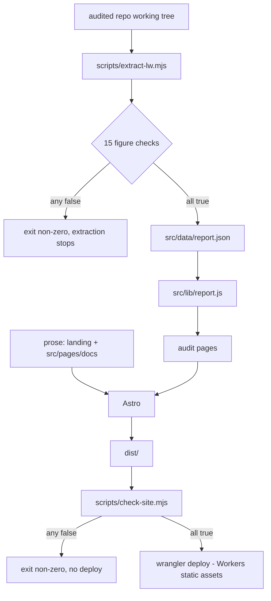

# PROCESS.md

How this site is built, and what has to be true before a change ships.

## The two rules

1. **Every extracted figure comes from a file in the audited repository.** `scripts/extract-lw.mjs`
   reads the repository, cross-checks the figures against each other, and writes
   `src/data/report.json`. If a figure cannot be read from a source file, it does not appear on the
   audit surface.
2. **Every written claim is a claim about a named commit.** The landing page and the documentation
   are prose; each documentation page names the files and the commit it was read from, and
   `scripts/check-site.mjs` keeps the structure honest (below). A number quoted in prose has to be a
   number the audit already verifies.

## Pipeline



`npm run verify` re-extracts into `.cache/report.verify.json` and diffs it against the committed
`src/data/report.json`, ignoring only the timestamp. It fails on drift, so a stale committed figure
cannot pass CI. `npm run deploy` runs extract → verify → build → verify:site → deploy, so neither a
stale figure nor a broken link can reach the public URL.

## The figure checks

The extractor refuses to write its output if any of these is false:

| check | what it catches |
|---|---|
| README counter block vs `tools/constructs.json` | the two tallies drifting apart |
| audit table vs `tools/constructs.json`, row by row, verdict included | an audit row added without a construct row, the reverse, or a construct reclassified on one side only |
| audit table vs `tools/constructs.json`, batch per row | a construct proven in a different batch on one side |
| facade census complete | a facade in the source that the audit never classified |
| MAP coverage index has no blank verdict | a documentation page silently dropped |
| MAP tally line vs the classes parsed from its own table | the table and the summary printed next to it drifting apart |
| README docs counter vs MAP row count | the same, from the other direction |
| the ledger table is read whole (G.3 section scan) | a blank line inside the ledger table truncating it. Not hypothetical: the table is interrupted by one blank line, and the parser used to publish 15 of its 19 rows |
| every ledger status is a known token (OPEN / DONE / TOLAK) | a shifted column making a status unreadable or invented |
| one feature-map row per area | a feature area that lost its rows in parsing |
| the feature map is read whole (MAP §5, counted line by line) | the same truncation class, in the section with seven tables |
| the severity bands are defined in the source | the audit paraphrasing what P1/P2/P3 mean and presenting the paraphrase as the project's |
| the verdict badge and the CI comment heading are both read from README | a typed-in verdict surviving a change to either string |
| every CPU figure the `/audit/coverage/` table prints is still a phrase in `COMPILED.md` | the one hand-shaped table drifting away from the file its caption names |
| the audit scratchpad row count is quoted from the source | the severity spread losing the denominator it came from |

The first two construct checks are per-row rather than tally-based on purpose: tallies can agree
while two rows are swapped. The audit table's own build column and per-row batch are compared and
then dropped from `report.json`, since no page renders the audit table — the construct's own
`verdict` and `batch` are the published fields. That is worth about 9 KB of the payload and one
fewer field to keep in sync.

## The site checks

`scripts/check-site.mjs` runs against `dist/` after a build. It reads files only — no network, no
browser, no dependencies — and refuses to pass if any of these is false:

| check | what it catches |
|---|---|
| documentation pages vs the navigation data, both directions | a page that exists but cannot be reached, or a navigation entry with no page |
| every internal link resolves to a built file | a moved page leaving dead links behind |
| no rendered text carries a literal backtick, a double-escaped ampersand, an unescaped `{{ placeholder }}` or stray markdown emphasis | markdown habits leaking into HTML. Tags are stripped first, so BEM class names do not count |
| exactly one `h1`, a real `<title>` and a description per page | a page nobody can link to or navigate |
| every image carries `alt` (empty when decorative) | the accessibility floor |
| the landing ships the pipeline figure (desktop and phone forms) and the budget figure | a visual quietly dropped in a refactor |
| at least 20 mini figures and 8 glyphs across the site | a section losing its diagram in an edit |
| every mini figure's own geometry fits its canvas | a diagram that renders with a clipped label — `MiniFig` refuses to build instead |
| every audit page carries the provenance footer, and lives under `/audit/` | the audit drifting out of its own section |
| the static assets exist, and `og.png` is a real image | a failed asset copy shipping a zero-byte file |

## Deliberately not published

`notes/PLAYBOOK.local.md` is gitignored in the audited repository: it is working-tree material, not
published text. The audit therefore republishes only its aggregate shape (row count, status tally,
severity spread, area counts) and never its item text. `/audit/ledger/` states this in the reader's
face rather than burying it.

`.opencode/context.md` is gitignored as well (`.gitignore` line 9), and it is read for one thing:
the definition of the P1/P2/P3 severity bands, which is quoted verbatim rather than paraphrased,
because a paraphrase would be this site's claim about the project's severity model.
`/audit/method/` marks both notes as untracked; the `tracked` flag on each entry of
`auditedRepo.files` is read from `git ls-files`.

## Corrections

Documentation prose is not generated, so it is the part that can be wrong. Every documented
mismatch found so far, and what caught it:

| date | what was wrong | found by | fix |
|---|---|---|---|
| 2026-11-08 | `docs/architecture` labelled the pipeline stages S2–S5 wrongly (compile/bundle/prove/gate instead of bundler/golden tests/gate/prerender); the landing said "six stages" | an audit of the docs against `README.md` §Architecture | both now use the repository's own S0–S6 names |
| 2026-11-08 | `docs/blade` claimed `trans_choice` compiles and that the corpus compares "status, headers and body" | same audit vs `README.md` §Compiles today and `compiler/tests/run-corpus.mjs` | `trans_choice` removed (unsupported); the corpus compares rendered output bytes, the *shadow harness* diffs request status/headers/body |
| 2026-11-08 | `docs/limits` printed an invented READINESS block for a queue refusal | same audit vs `build.mjs` and `tools/readiness.mjs` | the block now uses the compiler's own cause text and the real indentation |
| 2026-11-08 | `docs/blade` claimed custom directives have "registered renderers" | same audit vs `MAP.md` §5 | states they are not compiled yet and fail the build |
| 2026-11-08 | the hero headline's verdict was typed by hand and misattributed to "the gated verdict block in README.md" | review of the pages against `README.md` | read from the README badge and the CI comment heading, with a check that both still exist |

## Local development

```sh
npm install
npm run extract     # refresh src/data/report.json from ../laravel-workers
npm run dev         # http://localhost:4321
npm run build       # static build into dist/
npm run verify:site # the site checks, against dist/
npm run preview     # build, then wrangler dev (Worker + assets, real 404 path)
```

## Release

```sh
npm run deploy      # extract -> verify -> build -> verify:site -> wrangler deploy
```

After deploying, load the root, one documentation page, one audit page and one bad deep link: the
first three must render, the last must return the styled 404 page rather than a bare browser error.

## Verification recorded for the current revision

All of it in Chromium (headless) against the built output, both themes.

| what | how | result |
|---|---|---|
| every page renders | 22 routes fetched and inspected | 22/22 |
| internal links | every `href`/`src` in `dist` resolved against the filesystem | 826 links, 0 broken |
| text contrast, dark theme | computed colour pairs on the landing | min 4.9:1 (13 px muted), 18.3:1 (body) |
| text contrast, light theme | the same pairs on the paper ground | min 4.9:1, 18.3:1 |
| structure | one `h1` per page, labelled `nav`s, `alt` on every image | 22/22 pages |
| reduced motion | `prefers-reduced-motion: reduce` forced through CDP | every hero animation `none`, the static frame still complete |
| phone layout | 390 px, landing and a docs page | the pipeline becomes a stacked list (no horizontal scroll); the docs tree collapses into a closed drawer; the package links move to the footer |
| the hero figure | screenshots at two scroll positions, both themes | legible, and the static frame carries the whole diagram |
| the small figures | every `.mini-fig` measured in the browser; 21 across the site | box height matches the viewBox ratio; no clipped label |
| figure geometry | `MiniFig` estimates each label's width and each node's box against its canvas, and throws during the build | this caught 12 overflows (5 figures) on the first run |
| the audit surface | 7 pages, provenance footer, no dead navigation | all 7 render with the pinned-commit footer |
